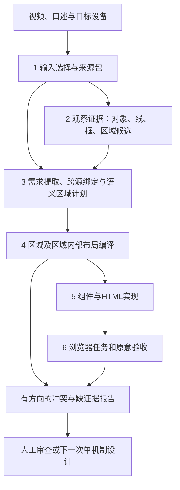

# 页面—区域—元素系统设计 v1：从证据理解到布局编译

日期：2026-10-29。性质：可评审设计草案，尚未实现或证明有效。用户已要求停止自动试验，mavis-ubuntu保持PAUSED；不启动50轮、不新增模型调用、不恢复定时、不修改冻结论文评分。

后续状态更新（2026-10-29）：用户已明确要求恢复每30分钟任务。上述暂停为成稿时历史状态；现按 [恢复协议](optimization_resume_protocol_20261029.md) 先实施最小契约原型，再通过导师证据审查决定真实生成验证。设计有效性仍未证明，冻结评分不变。

## 1. 先确定系统要解决什么

用户用视频展示手绘草图，同时口述要做的界面。系统需要生成符合目标设备的页面：主要区域内容保留、元素归属合理、比例与空间组织可信、基本操作可用。输入照片中纸张摆放的位置、拍摄纵横比、背景和透视，不是用户设计的网页布局。

一句话设计目标：**把观察事实、口述需求和布局决定分开保存，用有来源的区域与关系连接它们，再编译为目标画布中的可检查页面。**

本次不把问题定义为“找到完美外框”，不以多加Agent作为解决方案，不承诺换模型就成功，不将工程设计包装成已验证论文贡献。当前可以生成HTML，但尚不能稳定组织电脑页面；设计必须补足这一断点。

### 1.1 导师技能的思考模板

使用骆昱宇教授HKUSTDial/Supervisor-Skills的tech-paper-template及其thinking-template、consistency-checks；结合idea-evaluator关于数据否定和未测试的区别。这里借用挑战—模块—证据检查，不是在撰写论文或宣称新颖性。定位暂按Technique候选设计，不能据此宣称学术新方法。

| 思考项 | 本设计的回答 |
|---|---|
| 场景 | 从含背景/可能不完整的手绘视频和口述，组织手机/电脑界面 |
| 现有系统局限L1 | 照片观测坐标直接缩放为页面坐标，证据与设计几何混用 |
| 局限L2 | 口述、视觉身份与区域关系混在一次状态生成中，遗漏/重复/未决未被稳定区分 |
| 局限L3 | 错误归属可被确定性布局放大；标签反馈、尺寸落实不足以说明用户目标满足 |
| 关键思想 | 证据可追溯、语义决策显式、布局单独编译，不能互相覆盖职责 |
| 挑战C1 | 在页面外框不确定时仍保持坐标含义与空间关系可信 |
| 挑战C2 | 将多个观察与口述绑定为同一界面对象，并构建有证据的区域层次 |
| 挑战C3 | 将不完全/有冲突的语义计划编译为不会静默改变用户意图的可操作页面 |
| 模块A，对应C1 | 输入与观察证据包：图像、线/框/区域、坐标系与变换记录 |
| 模块B，对应C2 | 需求与语义页面计划：对象绑定、区域图、空间约束及未决 |
| 模块C，对应C3 | 布局与组件编译、冲突反馈、浏览器任务验收 |
| 待验证主张1 | A可避免将背景位置直接变成页面位置；证据见未来坐标契约和映射检验 |
| 待验证主张2 | B可减少区域遗漏/错属和跨源重复；证据见未来独立需求审查 |
| 待验证主张3 | C可减少新增遮挡且保留操作；证据见未来同源对照及实际浏览器任务 |

这些主张都不是当前成果；本文件只完成设计对应关系，不填写虚构准确率或新颖性评分。

## 2. 当前事实与设计边界

| 事实 | 来源 | 对设计的约束 |
|---|---|---|
| 47轮增加3条父关系，截图/坐标相同 | round47优化卡与原包 | 元数据改善不能代替页面收益 |
| 48轮把右侧对象归进左栏，布局再夹入，上传/发送同框 | 48轮trace013/014/015及实际命中测试 | 父归属冲突不能通过移动几何自动消失 |
| 49轮9个对象parent全空，guard未触发 | 49轮原始架构响应与guard账本 | 没声明区域必须明确报缺失，不能当“没有关系问题” |
| 49轮搜索中心被对话text覆盖 | 49轮浏览器hit_test.json | 布局几何和实际命中都要验收 |
| 构建身份时用vision归一化bbox乘目标viewport，覆盖模型bbox | src/utils/hierarchy_contract.py，build_structure | 保留视觉身份不能继续等于把视觉几何当页面几何 |
| 当前hierarchy_v1使用ui_architect_hierarchy.md | src/agents/ui_architect.py，generate_ui_state | 不把未激活的旧ui_architect.md手机提示误当本轮运行原因 |
| 当前DOM为page-root下平铺绝对定位，parent写在data属性 | src/utils/placement_contract.py | 语义包含、几何包含、DOM嵌套是三个不同指标 |
| 部分有action的区域会被编译为button，头像有action却没有操作反馈 | placement_contract.py、controlled_components.py及49实操 | 视觉形状、语义角色、交互能力必须拆开，不以action字符串决定一切 |

可保留：源文件/请求响应/实时trace/哈希、稳定ID、原生输入、受控渲染入口、浏览器实操。拟替换的是跨层契约与布局职责，不是全部重写。48和49的上游表现不同，不能按跨轮差异归因某个修复有效。

## 3. 总体流程：三模块、六阶段



箭头表示数据和责任，不表示每个方框都要新增一个Agent/一次模型调用。反馈不会自动无限循环调用模型。原始观察始终只读；后续每一版决定是新记录，不能就地改掉早先证据。

| 阶段 | 负责回答的问题 | 输出 | 不允许承担的职责 |
|---|---|---|---|
| 1 输入 | 用的是哪个时刻、哪些内容可见，目标设备从何得知？ | InputBundle | 不能先把最大矩形认成UI页，不能按照片宽高决定电脑/手机 |
| 2 观察 | 哪些对象/笔画/区域确实可见，在哪里？ | ObservationSet | 不按期待页面补看不见的控件，不输出最终CSS位置 |
| 3 语义 | 用户要什么，证据指向谁，属于哪个区域？ | SemanticPagePlan | 不以随意新建同义对象满足需求，不直接改观察bbox |
| 4 布局 | 区域如何占画布、对象如何在区域内排布？ | LayoutPlan与ConflictReport | 不改语义身份/类型，不夹入错误父框掩盖矛盾 |
| 5 实现 | 既定布局和动作如何落实成控件？ | RenderManifest、原始HTML | 不重新解释页面结构、不自行补后台或重排区域 |
| 6 验收 | 原需求和任务真的满足了吗？ | AcceptanceReport | 不把事件名/任意弹窗/坐标吻合当原意通过 |

## 4. 四份中间数据：必须分开

### 4.1 InputBundle：输入是什么

保存原视频/帧/口述文件哈希、精确时间戳及其是否已核实、方向变换、照片尺寸、选帧理由、可见性风险。纸张、手绘页面、最终网页分别命名。

后续选帧策略设计为：优先检查末尾展示时段，再按清晰度、内容完整性、遮挡与稳定性排序；末帧本身不能保证完整。找不到完整帧就报告，允许保留互补观察，但不能未经配准把不同帧坐标混拼。多帧融合/跟踪在v1不实施；本阶段保留单一可追溯主帧与不完整标记。

设备必须记录来源：明确口述/用户选择优先；缺失时可标推测或待确认。v1继续把375×812、1440×900作为已有比较画布配置，不宣称是所有设备的唯一标准。拍摄照片为竖图不等于目标网页为手机。

### 4.2 ObservationSet：看到了什么

观察ID不是界面对象ID。一件UI对象可对应框、文字、图标等多个观察；一个区域也可能有多条边或范围证据。

| 记录 | 必填语义 |
|---|---|
| observation_id、frame_id | 稳定身份与所属图像 |
| kind | text / glyph / line / closed_outline / region_extent / unknown等观察类别 |
| geometry | 类型、数值、coordinate_space、单位；不能只给一个无单位bbox |
| evidence | 原始像素位置、可见范围、来源方法/版本；可核对图像 |
| alternatives | 例如“圆形可能是头像也可能是返回图标”，不伪造确定类型 |
| uncertainty | 遮挡、截断、弱线、背透线/纸桌边混淆等；模型自报分不是校准概率 |

线保留端点、来源和可见区间；补角/拟合只能生成另一个derived候选，不能伪装原图观测。线可支持区域边界，但不会单独证明页面身份。区域范围可用粗框/多边形及不确定边，不强求四侧闭合。

### 4.3 SemanticPagePlan：用户要的页面是什么

包含下列数据，而不是一个同时承载所有信息的elements列表：

- requirements：由原口述/显式用户输入提出的需求，保存原文偏移、否定、作用对象及可观察完成条件；引文由代码按偏移取回。能核对引文不等于已完整提取所有需求。
- entities：界面对象。视觉外形、语义角色、组件类型、交互意图分别表示，允许某些字段未决。对象ID稳定，不以重命名创造第二份同义对象。
- bindings：需求/观察到对象的对应，允许一对象多证据；不允许两个实体竞争同一观察而不报歧义。相同名称不能直接合并，不同名称也不能自动认作不同对象。
- regions：页面根与局部区域。区域来源可为视觉范围、明确口述关系或已说明的组合推断；逻辑分区不要求手绘有外框，但不得用常见页面模板暗造内容。
- relations：in_region、left_of、above、same_row、order、align、ratio等独立关系；包含不推出邻接，位置接近不自动推出语义包含。
- dispositions：每项已提取需求、每个观察和拟议对象，都有accepted / unresolved / rejected及理由。明确“没找到对应”“不在当前范围”“多候选”“源冲突”；不能用null囊括所有失败。

页面根始终存在，表示目标画布，不表示已找到原图手绘边界。对象暂时挂根仅是未归类存储，不得算语义归属正确。侧栏/对话区等内容区不能因未检测到边框就全部省略；若来源仍不够，输出region_unresolved，不生成“已完整理解”的结论。

区分三种覆盖：已声明需求的处置覆盖、人工评估清单的需求覆盖、真实用户全部原意的覆盖。前者100%不能推出后两者，生成器不得读后两者的评测答案。

### 4.4 LayoutPlan：决定如何排版

显式记录目标viewport、区域树、区域相对布局、对象在区域内的顺序/对齐/尺寸约束、最终render_box、采用/未采用的证据及调整原因。未决项不会自动变成“无问题”。

语义对象和观察记录只读。布局只写render_box与布局决策账本；类型转换/身份合并必须返回语义计划层形成新的可审版本，不能藏在布局函数里。

## 5. 坐标契约：不再让一个bbox兼任四种意思

| 坐标空间 | 例子 | 用途 |
|---|---|---|
| image_px(frame_id) | 照片406×720中的像素 | 定位观察，区分桌面/纸面/草图 |
| image_norm(frame_id) | 相对该照片宽高0—1 | 仅是照片坐标另一种编码 |
| sketch_local(sketch_id) | 通过可靠页面映射得到的草图局部坐标 | 可选空间证据；边界不可靠时不可伪造精确映射 |
| region_local(region_id) | 局部区域内0—1位置/顺序 | 在区域内部组织元素 |
| viewport_px(plan_version) | 目标375×812或1440×900 | CSS与浏览器实现的唯一最终几何空间 |

只有已登记的转换才能连接这些空间。每个转换保存from/to、方法、参数/矩阵、输入哈希、有效范围与不确定性。旋转、裁图、透视变换都属于坐标转换；照片归一化不能直接改名为页面归一化。

两条映射路径：

1. 可靠的草图页面/区域对应存在：先变换到对应局部空间，再映射到目标区域；透视变换须有足够且可靠的对应，不能只因能算矩阵就接受。
2. 页面边界不可靠但语义关系明确：用区域顺序、相对比例和内容约束规划页面，视觉位置仅作软证据；标记semantic_layout路径及比例的不确定性。它不是精确几何还原，不会自动获得“高保真”评价。

例如，某编辑框在纸面下方，照片又含大量空桌面：系统可采用“在对话区下方、在右栏内部”的关系，不必把照片y=0.8硬乘900；但如果右栏比例无可靠依据，不能编造“与原稿比例完全一致”。默认布局可以给诊断草稿，必须标明哪些比例是默认。

坐标有非有限值、无空间标记、错误帧引用或无效变换时，不偷偷除1000/交换顺序/夹限；拒绝对应转换并报告具体记录。可在不使用坏几何的另一合法路径生成降级草稿，但不能把坏记录计为已映射。

## 6. 语义区域如何形成，以及怎样处理多方证据

### 6.1 来源按字段比较，不设“视觉永远赢”或“口述永远赢”

| 决策字段 | 首先检查的证据 | 不足时的处理 |
|---|---|---|
| 目标设备 | 用户明确指定、原文 | 标待确认；照片尺寸不作替代答案 |
| 是否可编辑/可点击 | 原文意图、对象绑定、视觉外形 | 区分组件能力未决与视觉类别已知 |
| 区域包含/左右顺序 | 明确语言关系、视觉范围/分割、全局空间组织 | 冲突逐项留存，不独立选最强四条边拼接 |
| 目标区域比例 | 可映射草图比例、明确数值要求、相对范围 | 不足则记录默认/区间，不能声称忠实还原 |
| 对象身份 | 同图证据与语义对应 | 同义/代词不能仅靠标签猜；歧义不合并、不补副本 |

证据相互独立性必须注明：同模型在一次响应里给的多个理由，不算多个独立投票；模型自报confidence也不等于概率。

### 6.2 缺、错、多都输出有方向的证据

冲突报告最小字段：conflict_id、涉及对象/区域、证据引用、违反的约束、影响、可支持的修订方向、尚需的证据、处置状态。

- 已确认属于页面的导航在候选页框下方：记录“底边可能过高或归属判断有冲突”，支持下移底边方向；先确认导航确属该页，不因任何框外涂鸦就扩框。
- 页框上方包入无UI证据的纸背线：记录“上方范围可能冗余”；没有标注完整内容时，无证据不能单独证明一定应裁掉，不能反向把删空白当正确。
- 一个输入有视觉与口述两份：先判断同一实体的多源属性；若语义绑定不唯一，报告身份歧义，不做两个输入假装两项都满足。
- 页面某要求未找到对象：记录缺失和来源；有明确口述但无视觉对应可作为spoken-only需求创建对象，但必须说明其位置约束从何而来，不伪造视觉bbox。

方向提示是候选修订建议，不能自动推动无界外扩/删减。任何修订仍需全局检查：四边联合兼容、内容范围、区域关系与相邻区域均要一致。

### 6.3 类型、语义角色和交互分开

圆形轮廓是观察；头像是语义角色；能打开个人资料是交互意图。三者可以属于同一实体，无需新建第二个按钮副本。实现时可用一个操作入口承载图像，稳定ID落在真正可操作节点，内部装饰图不另计UI对象。

容器/list具有action描述不等于整个区域就是button；历史标题、具体历史项、列表背景分开。image也不能仅因type=image就忽略明确的交互意图。被支持的类型转换需要原文/观察绑定与决策记录，不能按某个案例的标签硬改。

## 7. 布局编译：先区域，后区域内对象

1. 固定目标画布与页面根，建立已确认的主要区域图；检查必需区域的处置状态。
2. 根据left_of/above/顺序及比例约束确定区域布局；横向栏与纵向堆叠不能只按数组顺序猜。
3. 在区域内部，根据对象顺序、对齐、分组、可见比例和交互尺寸要求布局。框内文本与输入框边界不能作为两个互相竞争的巨大前景对象。
4. 检查父子范围、兄弟重叠、跨区域冲突、可读性和可操作性；父背景包含孩子不是遮挡错误。
5. 输出最终viewport_px坐标、变更账本和未决清单，再交组件编译。

硬规则：稳定身份、合法坐标空间、无循环、控制对象有足够可操作空间、组件能力符合确认的需求；原始观察不覆盖。软约束：手绘相对位置/比例、视觉对齐、留白。硬/软是设计策略，不是所有口述都自动降为软；用户明确的设备/包含/顺序需求必须作为语义要求检查。

出现不可兼容约束时给可复核冲突集合，不要求本版实现全局最小冲突集。不得删除需求、缩成一像素、覆盖未决或偷偷改变父级来“求得解”。只有原区域归属已确认且纯布局越界时，才可在明确策略下调整间距/换行/扩区域，并记录对其他区域的影响；不能继续对错属对象无条件fit_within_parent。

区域比例优先于无依据等分。输入图像中的粗略比例是候选证据，不保证所有栏按像素比拉伸；目标页面的尺寸与可用性可能要求适配，适配必须说明。

## 8. 组件与HTML：先沿用已可核对的实现边界

v1迁移先保留page-root下平铺实现，由区域布局计算最终全局坐标，避免一边重做语义一边重做嵌套坐标。语义树保存在计划中，DOM不嵌套不能算语义树不存在；反之，data-parent-id不算实际DOM嵌套。若后续采用Grid/Flex/嵌套渲染，另立单独比较，不与当前表示改造捆绑。

组件标签由确认的语义角色和交互能力联合决定。原生输入须能聚焦/输入/读回；容器/线/装饰默认被动；文本不能因粗bbox而无解释占据其他区域操作面。布局首先修正遮挡，不能仅用pointer-events关闭来掩盖错误空间组织。

反馈分级：

- 原生能力：能输入、能点击、能聚焦。
- 意图相关行为：触发原需求明确的局部状态/操作入口。
- 任务完成：达到该任务事先定义的可观察结果。

标签alert仅属点击确认。后端能力未实现时不能声称发送/上传/资料修改成功；v1不新增后端、多页面流程或未经原需求支持的业务功能。若当前比较范围只承诺原型点击确认，报告必须写该范围，同时把实际用户任务尚未实现留在未完成清单。

## 9. 门槛与失败路径

| 入口问题 | 行为 | 报告状态 |
|---|---|---|
| 文件身份/请求预算不合法 | 不启动模型 | input_or_budget_rejected |
| 观察几何缺来源/单位 | 隔离该条几何，允许其余合法证据继续 | observation_unresolved，不算完整覆盖 |
| 模型未输出必需数据段 | 按契约报告缺段，不默认为空成功；零自动重试 | contract_incomplete |
| 同一证据绑定多个实体/类型矛盾 | 保留原始提议，隔离有问题绑定 | semantic_conflict |
| 主要区域无可靠计划 | 不给“完整页面”状态；如有诊断草稿需明确标识 | page_plan_incomplete |
| 非关键对象局部不确定 | 可输出部分可用草稿和未决，不全局伪造或全局吞掉有效证据 | degraded_draft |
| 布局冲突无法解决 | 返回相关对象和修订方向，不用夹入通过 | layout_conflict |
| HTML缺控件/实际被覆盖 | 返回组件/命中证据 | browser_failed |

合法JSON、零未决和完整性是三件事。提议分母为0时记录不可评；没有输出义务覆盖时不允许把空清单当“0问题”。多源中一个失败不抹掉另一个有效源，也不得吞掉非法源使最终看似全通过；分源保留结果及整体可用状态。

## 10. 可审计产物与简化的数据示例

每次保存input_bundle、observations、semantic_plan、layout_plan、render_manifest、acceptance_report，以及原请求/响应和版本哈希。每层记录读取哪些版本、写哪些决定；模型原文、代码检查结果、人工复核结果分开。对象删除/合并/改型必须在账本里，未决不可在下一层无理由消失。

以下为合成示例，不是002/008答案，也不是已实现JSON schema：

```yaml
observation:
  id: obs_17
  frame_id: frame_a
  geometry: {space: image_px, bbox: [120, 410, 250, 440]}
  kind: closed_outline
requirement:
  id: req_4
  source: {transcript_id: speech_a, start: 52, end: 61}
  intent: editable_text
entity:
  id: node_8
  evidence_refs: [obs_17, req_4]
  visual_kind: outlined_rectangle
  semantic_role: message_editor
  interaction: {kind: text_edit, status: accepted}
membership:
  entity: node_8
  region: region_editor
  status: accepted
  evidence_refs: [req_4, relation_3]
placement:
  entity: node_8
  render_geometry: {space: viewport_px, bbox: [340, 760, 1180, 820]}
  reason: region_local_layout
  derivation_refs: [region_layout_2, relation_3]
```

示例数值与引文偏移仅展示字段关系，不能代替真实引文/映射/证据验证；node与obs不因格式完整就成为正确绑定。没有可靠映射时placement不伪装由obs_17直接几何变换得到。

## 11. 实现与调用预算：逻辑分层不等于调用增殖

未来可比较的最小执行安排，尚未启动：

- 模型调用1：完整主帧→观察对象/区域与线证据、歧义；不生成HTML或目标像素布局。
- 模型调用2：同一原图、已校验观察与原口述→设备、需求来源、绑定、区域/关系计划；不生成CSS坐标。必需字段的缺失会显式失败，语义完备性还需审查。
- 代码：坐标变换与约束布局、组件编译、浏览器检查。观察/语义验证不是第三个隐式模型调用。

保留现有Qwen配置、8192/600秒/零重试，每轮总预算仍≤3；默认设计用2，不自动使用剩余1次。结构化输出能力、输出长度与一次融合的承载能力尚需核对；不能仅把更多必填字段塞给现有架构提示就称完成分层。若2次安排无法承担职责，再单独比较可行职责拆分及固定成本，不暗增模型或依赖。

该安排不包含视频重选帧模型、独立ASR模型的新预算；若未来需改变输入预处理，应另写实验范围与成本。当前全部继续暂停。

## 12. 恢复验证前的工作，不以“再跑一次”代替

### 阶段D0：设计评审（当前）

确认三模块/四类数据、坐标/身份/语义契约、冲突处理及最终任务范围。仍待决定：比例证据不足时的默认策略、自动可接受与需澄清的边界、空间约束求解实现、双调用输出承载能力。它们是设计问题，不是已解决结果。

### 阶段D1：无模型的最小契约原型（未来，经用户恢复实施后）

用合成数据检查：照片背景变化不会直接改变目标页面位置；语义父级与观察位置冲突可被定位；缺区域不视为全页面成功；同一对象多观察不产生副本；区域容器不变成巨型按钮；图像入口可按已确认需求操作；0/0不算覆盖。只测契约、组件和失败路径，不称用户效果。

不把评测GT输入生成器，不修旧HTML；人工合成fixture不是用真实案例答案构造更好页面。旧响应只读审计可解释历史原因，不充当新生成收益。

### 阶段D2：恢复有界模型验证（仅用户明确恢复后）

先固定小开发诊断集，分别覆盖缺区域、错父、坐标变换、身份重复/交互错型。先检查机制前置条件，再确认该轮能否检验指定假设；触发条件未出现就报告不可评，不加调用挑触发。跨轮新采样好坏不归因候选机制。

优先比较中间表示契约，之后比较布局，最后检验实际新页面；每轮一个机制，不把重选帧/换模型/新表示/新渲染一起改。设备分例的页面效果仍是最终门槛。已有13例仍是开发材料，不能称未见泛化。

### 阶段D3：才讨论模型能力与跨例稳定性

在输入和职责固定后再评估“模型是否胜任”：格式完成、观察覆盖、需求绑定、区域关系分别计量。必要时才设计模型对照；当前无数据把问题归因模型规模，也无证据保证更大模型解决。新模型成本与调用授权不能暗改。

不把剩余3轮当必须跑完的指标；恢复时先重审窗口协议，不擅自增加总轮数或宣称旧窗口已达标。

## 13. 验收口径：结构、空间、操作分开

| 层 | 将来要回答的问题 | 不可替代它的指标 |
|---|---|---|
| 输入 | 主帧内容范围是否足够，设备来源是否正确？ | 图像文件存在、清晰度高 |
| 观察 | 用户画出的关键内容/线/区域是否被保留？ | JSON合法、对象很多 |
| 语义 | 已提取需求是否有来源、对象是否唯一、区域归属是否支持？ | ID唯一、引文字符串存在 |
| 空间 | 区域比例/顺序/包含是否符合证据与要求？ | 所有bbox在画布内 |
| 实现 | 确认的组件能力、布局是否正确落实？ | 有HTML、data-parent-id存在 |
| 用户任务 | 真实操作和原意是否满足？ | 同名弹窗、函数名像正确动作 |

继续沿用已确认论文12ER/12TR/21SR/8AS，新增开发诊断指标不替换论文口径。真实案例验收先冻结任务/分母，保留输入/请求/原HTML哈希，浏览器实操截图；先HTTP200再给页面预览。独立人工复核尚未具备，不能把同实施者审查当独立人工。

## 14. 旧代码迁移建议：先切断错误耦合

| 现有部分 | 拟处理 | 理由 |
|---|---|---|
| full_frame_input、输入哈希、trace、调用预算 | 保留并纳入InputBundle | 已有追溯能力，不需推倒 |
| vision_agent输出 | 拆出观察类别、空间与来源契约 | 防止照片位置直接变页面位置 |
| ui_architect_hierarchy输出 | 以SemanticPagePlan替换一体化UI-State职责 | 不再同时猜对象/父关系/最终像素 |
| build_structure视觉身份处理 | 保留对应校验，去除“身份正确就覆盖布局bbox”耦合 | 身份与几何所有权独立 |
| solve_hierarchy夹入与范围扩张 | 置于显式布局计划之后，取消静默修语义 | 先解释冲突，再决定布局 |
| 47槽位/49guard等可选实验 | 保留历史和测试，不默认叠加启用 | 未实证收益，前置条件不稳定 |
| placement_contract、controlled_components | 保留编译边界，修正角色/能力映射契约 | 既不把容器当按钮，也不丢图像入口能力 |
| 浏览器审计 | 保留，补语义目标和实际命中审查 | 点击确认与任务完成分级 |

先迁移语义计划/坐标接口，再逐项实现布局和组件规则；采用单一v2入口和版本标记，不在生产默认路径堆更多互相冲突开关。旧基线始终可复现，新入口成熟前不替换默认。此表是设计分解，不授权此刻改动这些生成文件。

## 15. 导师一致性审查与尚未解决的问题

| 审查链 | 设计层判断 | 实证边界 |
|---|---|---|
| 局限→关键思想 | L1—L3均对应“证据/语义/布局分离” | 不等于该思想优于简单基线 |
| 关键思想→挑战 | C1—C3分别是三类信息交接的真实障碍 | 不能把所有视觉漏检都归因表示 |
| 挑战→模块 | A/C1、B/C2、C/C3对应；六阶段是执行细分 | 每个模块能力仍需独立验证 |
| 模块→主张 | 三个待验证主张明确对应§4—§8与§13 | 无当前提升主张，不起草成功贡献 |

设计逻辑对应成立，但以下三项为MAJOR未决：区域/比例证据不足的可执行决策规则；有限预算下语义计划覆盖能力；冲突求解与任务完成的具体实现。它们不能用“加提示后应该行”代替。若后续发现任一核心假设被对照否定，按导师技能停止该主张并重新设计，不调门槛挽救。

本阶段交付到此：设计文件，不是可运行系统、不是论文成稿，不恢复自动验证。下一步先与用户评审上述未决，然后才选择最小契约原型；无理由立即跑完窗口余下轮次。

## 16. 参考依据与溯源边界

- 导师方法：[HKUSTDial/Supervisor-Skills](https://github.com/HKUSTDial/Supervisor-Skills)，本机tech-paper-template、idea-evaluator及其references；用于思路一致性和证据强度判断。
- 项目执行：skills/user-centered-optimization/SKILL.md；与导师技能分开。
- 设计需求与因果证据：docs/mentor_route_review_paused_20261029.md、round47/48/49卡、源代码与原包实时trace/浏览器审查。
- 既有研究解读：docs/链路诊断与Agent架构调研_20261027.md与docs/手绘页面定位与空间理解_学术路线复核_20261028.md。MM-WebAgent的全局/局部分工、Magic Layouts的结构思想仅为已记录启发，不是本坐标/融合协议的直接来源或复现。此次没有新增论文调研，也不据此宣称最新、最优或新颖。
